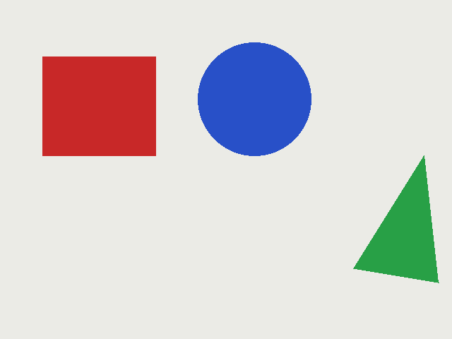

# th_basic_cv

A starting point for perception nodes: a basic OpenCV pipeline that runs on
bundled sample images or on any live camera topic.

For each frame it blurs, finds Canny edges in each color channel, and boxes
every outer contour larger than a minimum area. Each object is labeled with a
shape and a color, like `red triangle`. It publishes the edge map and an
annotated copy of the image, and logs the labels, mean brightness and
processing time once a second.

## How objects are labeled

- **Shape**: the outline is simplified to its corners. 3 corners is a
  `triangle`; 4 is a `square` if the sides are within 10% of each other
  (rotation doesn't matter), otherwise a `rectangle`; a round outline is a
  `circle`. Anything else is a `polygon`.
- **Color**: the average color inside the outline, named by hue: `red`,
  `orange`, `yellow`, `green`, `blue` or `purple`. Very dark is `black`; washed
  out is `white` or `gray`.
- Edges come from each color channel, not just grayscale, so objects that
  differ in color but not brightness (yellow on white) are still found.
- Limits: a hollow outline takes the color of whatever is inside it, colored
  light shifts the hue, and a busy background (a window, a bookshelf) gives
  many extra boxes. Plain backgrounds and even light work best.



## Nodes

### `sample_image_publisher`

Publishes every `.png`/`.jpg` in a folder on `image_raw`, one per tick, on a loop.

| Parameter | Default | Meaning |
| --- | --- | --- |
| `image_dir` | this package's `sample_images/` | Folder to read |
| `rate_hz` | `1.0` | Images per second |
| `frame_id` | `camera` | `header.frame_id` on each image |

### `basic_cv_node`

| Topic | Direction | Type |
| --- | --- | --- |
| `image_raw` | in | `sensor_msgs/Image` (`bgr8`, `rgb8` or `mono8`) |
| `image_edges` | out | `sensor_msgs/Image` (`mono8`) |
| `image_annotated` | out | `sensor_msgs/Image` (`bgr8`) |

| Parameter | Default | Meaning |
| --- | --- | --- |
| `blur_kernel` | `5` | Gaussian blur size in pixels (even values are rounded up) |
| `canny_low` | `50.0` | Canny lower threshold |
| `canny_high` | `150.0` | Canny upper threshold |
| `min_contour_area` | `200.0` | Ignore contours smaller than this, in pixels |

Parameters are read on every frame, so you can tune them while it runs:

```bash
ros2 param set /basic_cv_node canny_low 10.0
ros2 param set /basic_cv_node canny_high 30.0
```

## Build and run

Inside the dev container (see the repo README):

```bash
colcon build --packages-select th_basic_cv
source install/setup.bash
ros2 launch th_basic_cv basic_cv_demo.launch.py
```

Expected log:

- `01_shapes.png`: `3 objects: red rectangle, blue circle, green triangle`
- `02_blocks.jpg`: `5 objects`, one each of red, blue, yellow, green and purple
- `03_low_light.png`: `0 objects` until you lower the Canny thresholds; with
  the values above it finds a `gray rectangle` and a `blue circle`

To run on a camera instead, start any node that publishes images and point the
CV node at its topic:

```bash
# vision_test's camera node publishes on image_raw
ros2 run vision_test camera_node
ros2 launch th_basic_cv basic_cv_demo.launch.py use_samples:=false

# or a camera on another topic
ros2 launch th_basic_cv basic_cv_demo.launch.py use_samples:=false image_topic:=/image
```

To see the output, open `image_annotated` or `image_edges` in Foxglove or
`rqt_image_view`.

## Tests

```bash
colcon test --packages-select th_basic_cv
colcon test-result --verbose
```

The gtest suite checks shape and color naming on their own, the full pipeline
on drawn scenes and on the sample images (counts and labels), and the image
conversions.

## Code layout

- `src/basic_cv.cpp`: the pipeline itself, plain OpenCV with no ROS, so it
  is easy to test and reuse.
- `src/image_conversions.cpp`: `sensor_msgs/Image` to and from `cv::Mat`
  without `cv_bridge`, which the base Docker image doesn't include.
- `src/basic_cv_node.cpp`, `src/sample_image_publisher.cpp`: thin ROS wrappers.
- `scripts/make_sample_images.py`: regenerates `sample_images/`.
